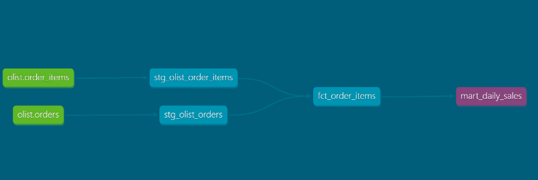

# E-Commerce Analytics Warehouse | dbt + BigQuery

An end-to-end analytics engineering project transforming the Brazilian Olist e-commerce dataset into a reliable, documented and analytics-ready cloud data warehouse.

## Tech Stack

- **Cloud Warehouse:** Google BigQuery
- **Transformation:** dbt Core, SQL, Jinja
- **Data Modelling:** Dimensional modelling, fact and dimension tables
- **Data Quality:** dbt generic and custom SQL tests
- **Automation:** GitHub Actions
- **Development:** Python, Git, VS Code

## Architecture



### Data Sources

Four datasets: Orders, Order Items, Customers and Payments.

### Staging Layer

- `stg_olist_orders`
- `stg_olist_order_items`
- `stg_olist_customers`
- `stg_olist_payments`

### Analytics Layer

- `dim_customers` — Customer dimension
- `fct_order_items` — Order-item fact table
- `mart_daily_sales` — Daily delivered-order sales metrics

## Data Quality

Implemented **14 dbt tests**, all passing in the validated local run.

Validation includes:

- Primary-key uniqueness and non-null checks
- Customer referential integrity
- Non-negative financial values
- Source-to-fact row-count reconciliation
- Daily sales date uniqueness

## Incremental Processing

The order-item fact model uses BigQuery incremental materialisation with a unique composite order-item key.

The current implementation supports append-only processing. Handling updates to existing orders is a future enhancement.

## Business Analytics

The warehouse supports analysis of:

- Daily order volumes
- Merchandise and freight values
- Customer geography
- Delivered-order trends
- Order-item transaction patterns

## Project Structure

```text
models/
├── staging/
└── marts/

tests/
ci/
.github/workflows/
dbt_project.yml
requirements.txt
```

## Running the Project

```bash
pip install -r requirements.txt
dbt debug
dbt build
dbt docs generate
dbt docs serve
```

Requires an appropriately configured BigQuery project and dbt profile, together with the four Olist raw source tables.

## Dataset

Olist Brazilian E-Commerce Public Dataset, available on Kaggle.

## Future Improvements

- Change-aware incremental processing
- Warehouse-level CI integration tests
- Automated production scheduling
- Additional business metrics and dashboards